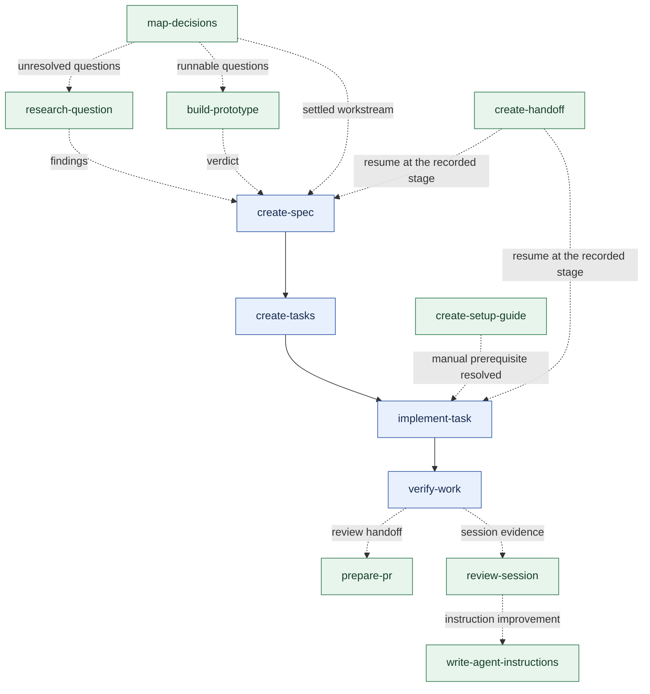

# Skill gap map

> `create-setup-guide` was withdrawn on 2026-11-10 after its evaluation stayed incomplete. This map keeps it as designed; the skill itself is in git history only.

Design original skills around the jobs Adrian's toolbox does not yet own. Keep the existing seventeen skills as the foundation. Use other collections to identify useful capabilities; derive the instructions, artifacts, and tests from this repository's users and conventions.

The user requested this map and explicitly ruled out direct copying. They subsequently approved the eight core additions, requested implementation, and selected full evaluation. All eight are implemented locally. Seven pass their declared local evidence gates; setup remains provisional. The [implementation log](specs/2026-10-05-skill-gap-implementation.md) and [evaluation report](../evals/gap-skills-2026-10-05/README.md) track their evidence and limits. The two conditional additions and optional improvements below remain separate from the core batch.

## Where the gaps sit

The existing toolbox owns requirements, task planning, bounded implementation, feature delivery, diagnosis, review, verification, simplification, and engineering guidance. The largest gaps are obtaining external evidence, learning through experiments, moving work between sessions, preparing a reviewable PR, and learning from completed sessions.

In this map, green nodes are the new candidates and blue nodes are the existing foundation. Arrows show useful handoffs, not mandatory steps or hard installation dependencies. Use only the parts a request needs.

`deliver-feature` remains the coordinator for the existing delivery pipeline. `create-handoff` can transfer any kind of work, including research, reviews, and incomplete investigations. `review-session` can examine any session, including one that failed before implementation.

## Skills I would create

| Proposed name | Gap and concrete request | Output and completion test | Boundary with existing skills |
|---|---|---|---|
| **research-question** | External facts are needed before a decision. “Check whether this API supports resumable uploads.” | A cited answer with version/date context, conflicting evidence, unknowns, and the implication for the decision. Done when material claims trace to primary sources and the question is answered or its remaining blocker is named. | `understand-codebase` explains local code. This skill investigates external facts. `create-spec` owns product decisions made from those facts. |
| **build-prototype** | A design question needs a runnable experiment. “Can users understand this permission flow?” | The smallest useful experiment, a run command, observations, and a verdict against a stated criterion. Done when the experiment runs and distinguishes the choices being considered. | `explore-options` generates alternatives. This skill tests one uncertainty. Production implementation remains with `implement-task` or `deliver-feature`. |
| **create-handoff** | Another session or teammate needs to resume accurately. “Leave enough context for someone to finish this investigation.” | A compact resume packet: goal, current state, branch/worktree, relevant artifacts, observed checks, blockers, and next action. Done when the next agent can locate the work and identify what remains without reconstructing the conversation. | Existing feature artifacts retain their authority. The packet points to them and records only context they do not contain. It works for tasks outside the delivery pipeline. |
| **prepare-pr** | A finished branch needs a coherent reviewer handoff. “Prepare this branch for a pull request.” | A title and body grounded in the actual base/head diff, repository template, observed validation, and material risks. Done when the draft describes the complete change and clearly separates passed, failed, and unrun checks. | `review-code` finds defects; `verify-work` tests readiness. This skill packages their evidence. Publication is a distinct requested action; it does not imply merge authority. |
| **review-session** | Repeated agent friction needs a concrete prevention mechanism. “What should we improve after this session?” | A short ranked report: observed failure or friction, supporting event, likely cause, smallest remedy, and how to verify the remedy. Done when each recommendation traces to session evidence and has a checkable expected result. | `review-code` examines a change. `diagnose` establishes a bug's cause. This skill examines the working process and environment. `build-loop` retains ownership of automation repair. |
| **create-setup-guide** | A human must complete dashboard, credential, or access steps the agent cannot perform. “Make this service setup repeatable for the next developer.” | An ordered guide, plus an interactive runner when it materially helps: prerequisites, destinations for captured values, checkpoints, recovery, and a completion check. Done when the instructions match current service docs and the runner passes local fixture checks without contacting real services. | Ordinary executable agent work stays with the agent. This skill handles the human portion. `build-loop` designs scheduled automation, not human setup. |
| **map-decisions** | A large effort contains several unresolved workstreams. “Map what we need to decide before migrating our billing system.” | A local project map indexing bounded decision records, dependencies, evidence needs, resolved answers, and the next unblocked decision. Done when known questions have owners and dependencies, unknown areas remain explicit, and settled work can enter a spec. | `create-spec` settles one bounded plan. `create-tasks` decomposes confirmed implementation work. This skill organizes uncertainty across plans and sessions. |
| **write-agent-instructions** | Persistent project instructions need careful design. “Fix our AGENTS.md so agents find the right guidance and stop repeating this mistake.” | A minimal evidence-linked revision using existing conventions, conditional pointers, and an example of the behavior it should change. Done when the original failure is caught or prevented and unaffected behavior remains intact. | `create-skill` owns skill authoring and its release gates. This skill owns project steering documents. `be-concise` improves communication, not durable agent policy. |

## What makes these Adrian's designs

| Skill | Design decision |
|---|---|
| research-question | Organize the output around the decision and uncertainty. Record source applicability and conflicts. Use a focused synchronous lookup for small questions; delegate only when the work and harness justify it. |
| build-prototype | Choose the experiment from the question and success criterion. Allow a CLI probe, simulation, clickable flow, or small UI. A fixed HTML format or fixed number of visual variants is unnecessary. Preserve the useful verdict according to repository conventions. |
| create-handoff | Verify repository state and referenced artifacts before describing them. Preserve incomplete work and user changes. Use an agreed local destination; avoid imposing one temporary-directory convention on all users. |
| prepare-pr | Follow the repository's PR template and scale the explanation to the change. Use a diagram when it clarifies behavior. Record evidence actually observed; avoid inventing a before-state or labeling an unrun check as passed. |
| review-session | Trace observed friction to a specific remedy. Prefer a deterministic check for a mechanical error. Recommend a policy only when a check cannot express the decision. Keep recommendation and application separate. |
| create-setup-guide | Start with the manual dependency and its completion check. Generate a runner only when better than a short checklist. Make retries preserve unrelated configuration and report partial completion accurately. |
| map-decisions | Use local files and the existing spec conventions by default. Keep implementation tasks separate from open questions. Discover more questions as evidence arrives; avoid manufacturing a complete plan too early. |
| write-agent-instructions | Preserve user policy and place each rule in its owning layer. Improve navigation or existing instructions before adding more policy. Prove the intended behavior change with fixture tasks. |

Each eventual skill belongs at `skills/<proposed-name>/SKILL.md`. Add bundled references, templates, or scripts only when its cases need them. Keep runtime resources inside that directory. Sibling skills are optional helpers with a working inline fallback, following [Toolbox Anatomy](toolbox-anatomy.md) and [ADR-0001](adr/0001-self-contained-skills.md).

## Improve existing coverage

These ideas belong in the current toolbox before a new skill is considered.

| Existing owner | Proposed improvement | Evidence to require |
|---|---|---|
| [diagnose](../skills/diagnose/SKILL.md) | Redact credentials from commands, logs, and captured artifacts. Track authorized temporary instrumentation so cleanup can be checked. Retain its tight reproduction, causal evidence, and diagnosis-only boundary. | A secret-bearing fixture stays redacted; an authorized fix removes temporary probes; diagnosis-only still leaves files unchanged. |
| [engineering-best-practices](../skills/engineering-best-practices/SKILL.md) | Strengthen `Align` with recent-change evidence, ranked architectural friction, and before/after diagrams where useful. Use its existing charter and migration mechanisms. | Findings cite actual friction; a coherent architecture produces no invented refactor; a selected change preserves its agreed behavior. |
| [deliver-feature](../skills/deliver-feature/SKILL.md) | Consider an optional scheduler for independent tasks with explicit file ownership, worktree isolation, integration checks, and a serial fallback. Keep whole-feature verification. | Blocked tasks never start; overlapping ownership prevents unsafe concurrency; integration failures remain visible; user changes survive cleanup. This is a separate automation project. |
| [create-spec](../skills/create-spec/SKILL.md) | Improve domain clarification and glossary consistency within the existing artifact contract. | Overloaded terms are resolved and recorded; old confirmed decisions are preserved; implementations are not smuggled into glossary definitions. |
| [be-concise](../skills/be-concise/SKILL.md) | Add a focused clarification response for “I don't understand”: restore missing context, explain the mechanism, and use one concrete example. | The explanation adds the missing information instead of repeating or merely shortening the previous answer. |
| [create-skill](../skills/create-skill/SKILL.md) | Keep authoring guidance and context-pointer rules in their existing owning references. Share a principle by reference where installation boundaries permit. | A project-instruction task and a skill-authoring task route to their correct owners; neither creates competing copies of release rules. |

This revises the earlier suggestion to add `improve-architecture`. The current [Align workflow](../skills/engineering-best-practices/references/align.md) already assesses architectural direction, records an approved target, and plans migration. A second entrypoint needs demonstrated recurring value beyond that coverage before it earns a place.

## Conditional additions

| Name | Create when | Distinct outcome |
|---|---|---|
| **triage-issues** | Incoming reports or external PRs repeatedly need verification and preparation. | Establish duplicate/existing behavior, reproduce the claim where possible, and produce an actionable brief or a precise information request. Draft local recommendations first; publish comments or change tracker state only within the user's request. |
| **create-questionnaire** | A decision repeatedly depends on someone who is not in the session. | Produce an async questionnaire matched to that person's knowledge, covering the specific unanswered decisions with a usable response format. `create-spec` remains responsible for incorporating the answers. |

General teaching, a skill router, and a mandatory toolbox setup command have lower priority for this engineering-focused repo. Revisit teaching if an ongoing learning workflow becomes a real requirement. Start with the README for discovery and repository conventions for configuration; add a router or setup workflow only after repeated friction demonstrates the need.

## Recommended build order

| Batch | Candidates | Why this order |
|---|---|---|
| 1 — Evidence and continuity | research-question, build-prototype, create-handoff | Fill clear gaps around the existing planning and delivery pipeline. |
| 2 — Review handoff and feedback | prepare-pr, review-session | Make completed work easier to assess and turn actual mistakes into improvements. |
| 3 — Manual prerequisites | create-setup-guide | Useful for recurring access/setup blockers; the runner deserves independent failure and secret-handling tests. |
| 4 — Larger efforts and durable instructions | map-decisions, write-agent-instructions | Add when the underlying multi-session or persistent-instruction burden is concrete. |

Build and evaluate one candidate at a time. Batch membership does not require every candidate to ship. A prompt, template, or script may satisfy the same job at lower maintenance cost.

## Proof each proposal must earn

These are suggested future case classes, not executed tests or frozen eval contracts.

| Candidate | Normal case | Edge or pressure case |
|---|---|---|
| research-question | Determine an API capability from applicable official docs. | Conflicting versioned docs; no authoritative answer; a request for certainty the evidence cannot support. |
| build-prototype | Run an experiment that distinguishes two state or UI choices. | Ambiguous success criterion; pressure to turn the prototype into a production feature. |
| create-handoff | A fresh agent resumes from the packet and completes a bounded next action. | Dirty workspace, stale evidence, missing artifact, or sensitive material. |
| prepare-pr | A reviewer understands the actual diff and observed checks. | Wrong base, unrelated commits, failed checks, or a draft-only request that must not publish. |
| review-session | A recorded failure yields a remedy that would catch the same failure. | An existing check is merely unwired; an unexplained delay has insufficient causal evidence; pressure to add broad instructions. |
| create-setup-guide | A fixture-driven runner completes and verifies its declared local outputs. | Retry after interruption, special characters in values, hidden input, existing configuration, rejected confirmation, or unavailable tooling. |
| map-decisions | Resume a multi-workstream map and resolve the next unblocked question. | Cyclic dependencies, changed evidence, or premature implementation before a decision is settled. |
| write-agent-instructions | A fixture task stops making the observed instruction-related error. | Conflicting user policy, missing referenced guidance, redundant instructions, or a skill-authoring request belonging to create-skill. |

Use [CONTRIBUTING](../CONTRIBUTING.md) to choose the actual evidence tier. Reversible local artifact workflows generally start at Tier 2. External publication, secret-handling runners, automation, and meta-skills need Tier 3. Proposed local `prepare-pr` writing and any published-PR variant must be evaluated at their own consequence. `review-session` and `write-agent-instructions` should be treated as Tier 3 when evaluating or changing durable agent behavior. Freeze cases, costs, subject hashes, and acceptance criteria before actor runs. A shorter body or a clean structural check is not evidence of improved outcomes.

## Accepted implementation choices

- **PR scope:** implement the approved recommendation: local drafts by default, opening/updating only when requested, and no implied merge authority. Evaluation uses mocked publication.
- **Invocation:** natural-request discovery for research-question, build-prototype, create-handoff, prepare-pr, and create-setup-guide. Explicit invocation for review-session, map-decisions, and write-agent-instructions. Existing routing cases remain unchanged; native installed tests are separate evidence.
- **Artifact locations:** follow the target repository's convention, with self-contained local fallbacks in each body.
- **Audience and budgets:** retain the engineering audience. The user selected full evaluation; the [implementation log](specs/2026-10-05-skill-gap-implementation.md) records finite operational defaults and the observed, opaque model route.

The core batch has local drafts and frozen per-skill evidence packages. Evaluation must finish before a release verdict. This work does not install, commit, or push the candidates.

## Comparison sources

The comparison uses Matt Pocock's upstream `main` catalog and source files inspected on 2026-10-05. These are live links, not a frozen upstream release. Source ideas identify capabilities; the proposed designs and names above are tailored to Adrian's repo. No upstream skill body, template, or script was imported.

- [Latest catalog](https://github.com/mattpocock/skills/blob/main/README.md): research, prototypes, handoffs, tracker triage, questionnaires, and broader teaching/router capabilities.
- [PR](https://github.com/mattpocock/skills/blob/main/skills/engineering/pr/SKILL.md): evidence and reviewer communication.
- [Retrospective](https://github.com/mattpocock/skills/blob/main/skills/engineering/retro/SKILL.md): session-based environment improvements.
- [Wizard](https://github.com/mattpocock/skills/blob/main/skills/engineering/wizard/SKILL.md): guided human setup steps.
- [Wayfinder](https://github.com/mattpocock/skills/blob/main/skills/engineering/wayfinder/SKILL.md): resolving large efforts through a map of decisions.
- [Writing for agents](https://github.com/mattpocock/skills/blob/main/skills/productivity/writing-for-agents/SKILL.md): instruction hierarchy and context pointers.
- [Architecture improvement](https://github.com/mattpocock/skills/blob/main/skills/engineering/improve-codebase-architecture/SKILL.md) and [codebase design](https://github.com/mattpocock/skills/blob/main/skills/engineering/codebase-design/SKILL.md): architectural friction, interface depth, and testability.
- [Implement spec](https://github.com/mattpocock/skills/blob/main/skills/engineering/implement-spec/SKILL.md): dependency-aware integration of parallel implementation.
- [Diagnosing bugs](https://github.com/mattpocock/skills/blob/main/skills/engineering/diagnosing-bugs/SKILL.md) and [wait-what](https://github.com/mattpocock/skills/blob/main/skills/productivity/wait-what/SKILL.md): targeted improvements to existing diagnosis and communication skills.
